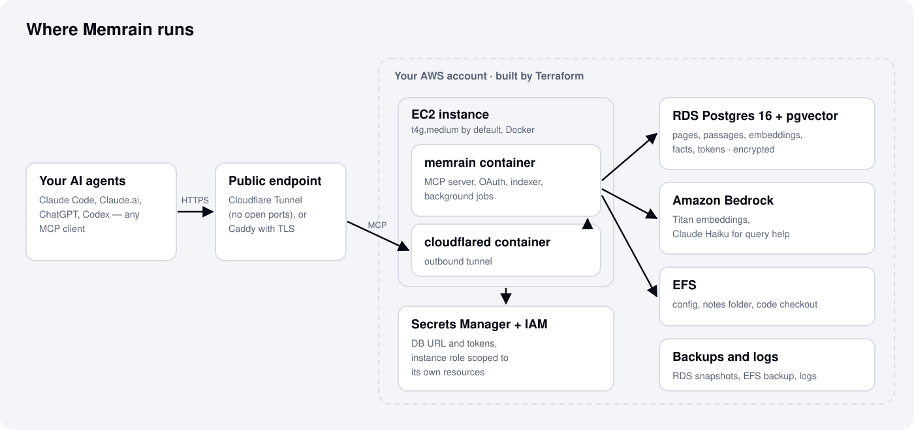

# ARCHITECTURE.md

This page shows what runs where: the AWS resources, the containers, and how a
request reaches Memrain. It is for people who run, change or review the
infrastructure. To install Memrain, start with
[docs/QUICKSTART.md](./docs/QUICKSTART.md); for a plain tour of how it answers
a question, read [docs/HOW-IT-WORKS.md](./docs/HOW-IT-WORKS.md).

<picture>
  <source media="(prefers-color-scheme: dark)" srcset="docs/assets/architecture-dark.svg">
  
</picture>

> Source-of-truth diagram + inventory for the `memrain` stack.
> Updated alongside every terraform / compose / systemd change.

## Topology

```
              MCP clients (Claude Code, Cursor, Codex)
                            │
                  https://brain.<domain>/mcp
                            ▼
                   cloudflared (sidecar)
                            │
            ┌── docker-compose internal bridge ──┐
                            │
                          memrain  (GET /health · POST /mcp)
                            │
        Bedrock Titan v2 (embeddings) + Claude Haiku (intent/expansion)
                  + opt-in Claude Sonnet (LLM synthesis)
                            │
                  RDS Postgres + pgvector
                            │
                  EFS (container runtime state)
                            │
                  AWS Secrets Manager
```

The stack runs as one VPC + one EC2 + one RDS + one EFS in a single
AWS region. There are no autoscaling groups, no orchestrator, no
external message broker — the whole runtime fits in `t4g.medium`.

## Container inventory

| Container | Image | Owns |
|---|---|---|
| `memrain` | built from `deploy/memrain/` (Bun + Alpine) | Knowledge brain: hybrid search (+ graph-signals ranking), entity + code call graph, code/markdown chunkers, fact extraction, push-context, advisor, MCP server (96 tools), a maintenance cycle (13 deterministic phases + 11 opt-in LLM-synthesis phases). Every route except `GET /health`, the OAuth metadata and flow endpoints (`/.well-known/*`, `/authorize`, `/token`, `/register`, `/revoke`) and the `/admin` pages (which carry their own login) needs a credential; `POST /mcp` is the agent contract and `POST /ingest` takes OAuth bearers with the `write` scope. Bedrock: Titan v2 embeddings, plus opt-in Claude Haiku (intent/expansion/rerank) and the opt-in, off-by-default Claude Sonnet note synthesis. Answer synthesis is the MCP client's job. |
| `cloudflared` | `cloudflare/cloudflared:2025.4.0` (upstream) | Public HTTPS ingress (Cloudflare Tunnel), the default `ingress_mode`. The dashboard routes `brain.<domain>/mcp` to Memrain on the internal docker bridge. |
| `caddy` | `caddy:2.10` (upstream) | The alternative ingress (`ingress_mode = "caddy"`): terminates TLS with Let's Encrypt on the instance's own public IP, no tunnel. Runs as a compose override, so exactly one of the two ingress containers exists per deployment. See [`docs/DEPLOYMENT.md`](./docs/DEPLOYMENT.md#alternative-caddy-ingress-no-cloudflare). |

Inter-container ports are not exposed to the host. `cloudflared`
reaches the Memrain MCP server over the compose `internal` bridge
network on `memrain:18790`. The service also answers to the network alias
`memex`, so an ingress configured before the rename to Memrain keeps working
in 1.0.x.

## Memrain daemon — internal modules

Beyond the per-recipe code under `deploy/memrain/src/recipes/`, the
daemon ships a handful of focused infrastructure modules. Listed here
so future contributors don't reach for them blindly.

| Module | Responsibility |
|---|---|
| `core/engine/{factory,pglite,postgres,interface}.ts` | Engine abstraction. `factory.makeEngine(config)` returns either a PGLite (dev fallback) or postgres-js adapter; both implement the same `transaction()` surface so the migration runner can be atomic on either backend. |
| `core/path_guard.ts` | Confines the `index` MCP tool's `path` argument to `MEMRAIN_VAULT_PATHS` / `MEMRAIN_CODE_PATHS`. Uses `realpathSync` so a symlink inside the vault that points outside is resolved + rejected. Dotfile / `.env` / `.git` / `.obsidian` / `.ssh` / `credentials` deny-list applies even inside an allowed root. |
| `core/concurrency.ts` | Tiny FIFO `Semaphore` used by the file sweep to bound concurrent `indexFile()` calls. Avoids the busy-wait + non-deterministic ordering of `while inFlight.size >= N: await sleep`. |
| `http/body_limit.ts` | `parseJsonBody<T>(req)` — 1 MiB POST body cap (override via `MEMRAIN_MAX_BODY_BYTES`). Returns either parsed JSON or a ready-built `413`/`400` Response. Every POST handler uses this. |
| `http/public_guard.ts` | Detects a public Cloudflare-tunnel request (presence of `Cf-Connecting-Ip`), enforces bearer auth via `crypto.timingSafeEqual` on equal-length Buffers, and rejects mutating tools unless `MEMRAIN_PUBLIC_WRITE=1`. |
| `mcp/http_transport.ts` | MCP JSON-RPC POST handler. Public and internal traffic key into separate `RateLimiter` instances — public uses Cloudflare's `Cf-Connecting-Ip`, internal collapses to a single "internal" bucket (XFF / X-Real-IP are attacker-controlled and would defeat per-IP limits). |
| `mcp/rate_limit.ts` | Token-bucket limiter with periodic idle-bucket eviction + `maxKeys` cap — bounded memory under high public IP variety. |
| `core/migrate.ts` | Single-tx migration runner: `engine.transaction(tx => { tx.exec(sql); tx.query("INSERT INTO migrations …") })`. A crash between the two phases used to leave the migration applied-but-unrecorded → re-run on next boot, breaking non-idempotent SQL. |
| `core/code-graph.ts` + `core/code-edges.ts` + `core/code-entities.ts` + `core/code-walk.ts` + `core/chunkers/code.ts` | Code intelligence: indexing + call graph. `memrain index` auto-detects source files (TS/Python), and the `code_callers` / `code_callees` / `code_def` / `code_refs` tools answer who-calls-what over `entity_mentions`, and `code_flow` / `code_blast` do a bounded transitive traversal (`walk_depth`). |
| `core/context/*` | Push-context (deterministic, no LLM): `volunteer.ts` extracts entities from a conversation window and resolves them to pages by alias/title/slug; `volunteer-events.ts` logs what was volunteered for a feedback metric. Backs the `volunteer_context` tool + `memrain watch`. |
| `core/advisor/*` | Read-only diagnostics: ranks pending migrations / stalled jobs / low embed coverage / setup smells into `{severity, fix_command}` findings (the `advisor` tool). Reuses the doctor/status/jobs primitives. |
| `core/synthesis/*` + `core/llm/{haiku,sonnet}.ts` | **Opt-in, off-by-default** LLM synthesis phases: `extract-atoms → synthesize-concepts → propose-takes → grade-takes → calibration-profile`, plus `reflections`, `patterns` (theme miner), `probe-contradictions`, and `deep-synth`. `think` runs the same relational-LLM pass as the opt-in `think` MCP tool and `memrain think` (both need `MEMRAIN_THINK=1`), with an entity-extract auto-anchor. Output is written ONLY to dedicated `synth_*` tables — `documents`/`chunks`/`pages` are never mutated. `haiku.ts` (utility) and `sonnet.ts` (paid slices) are the shared Bedrock helpers, each with an injectable seam so tests run with zero Bedrock calls. |
| `core/facts*` (`facts-extract` · `facts-classify` · `facts-reconcile` · `facts-recall` · `facts-decay` · `facts-fence` · `facts-queue`) | Structured entity facts. On-write extraction pulls `{subject, predicate, object}` triples into `entity_facts`; `facts-fence.ts` renders the deterministic "facts fence" block appended to a page; reconcile dedups + supersedes stale facts (with a `forgotten_cause` audit) and decays confidence over time. Paid Sonnet tier, default-OFF; the `entity_facts` tool reads them back and `add_fact` / `forget_fact` mutate them. |
| `core/content-sanity.ts` | Ingest quality gate. Scores incoming chunk text against junk/boilerplate patterns (plus an operator literal channel, `MEMRAIN_SANITY_LITERALS_FILE`) and quarantines scraper garbage before it is embedded. Fail-open. |
| `core/contextual-reembed.ts` + `core/search/contextual-llm.ts` | **Opt-in** contextual retrieval (LLM tier): before embedding, a Haiku pass prepends a short document-situating blurb to each chunk so the vector carries whole-doc context. Tracked by `chunks.contextual_embedded` (migration 057); `memrain reindex --contextual` re-embeds the corpus. |
| `core/search/query-cache.ts` | Semantic query cache (migration 065): a normalized-query + embedding-nearest lookup that returns a prior result set when a new query is semantically close enough, saving a full hybrid retrieval + embed round-trip. |
| `core/embed-backfill.ts` + `core/embedding.ts` | Embed provenance. Every vector is stamped with an `embedding_signature` (model + dim + contextual flag, migration 066); the opt-in `MEMRAIN_REEMBED_ON_SIGNATURE_CHANGE` auto-invalidates + re-embeds any row whose stored signature drifts from the current one. `core/embed-skip.ts` marks oversize / junk frontmatter as keyword-only (indexed, never embedded). Re-indexing a doc reuses a chunk's stored vector when its text is unchanged, so an edit only pays to embed the chunks that actually moved. |
| `core/scope.ts` + `core/visibility.ts` | Source scoping. Every row carries a `source_id` key; application-layer scoping + write-time fail-closed checks confine each remote credential (OAuth client / PAT) to its granted sources, and `scope.ts` defines the OAuth scope hierarchy (`read`/`write`/`admin`/`sources_admin`/`users_admin`/`agent`) the ingress gate enforces. |
| `mcp/visibility.ts` | The one predicate behind `tools/list` and `tools/call`: the ingress walls (public denylist, internal-token wall) and the per-credential gates (fail-closed write source, operator-only tools, per-op scope, slug-bound deny-by-default). `tools/list` advertises exactly the tools it finds no refusal for, so a listed tool is never refused for scope or permission. Argument-level refusals (a slug outside the bound prefixes) stay in dispatch. |
| `core/write-requests.ts` | Retry-safe writes. A `request_id` on `page_put`, `page_append`, `add_fact` or `add_timeline_event` claims a `write_requests` row keyed by caller grant, tool and id; a retry with the same arguments replays the stored result, other arguments are refused, and a retry during the first call gets `request_in_progress`. Conditional writes (`expected_version`) are checked in `core/pages.ts` under the slug's write lock. |
| `core/cycle/phase-context.ts` | Cycle fencing. Each phase runs with its own abort signal and a lock fence in async context: `phaseCheckpoint()` at the top of each loop iteration stops a timed-out or aborted phase, and `phaseFenceCheck()` before a shared-state write confirms the cycle lock still carries this run's tenure, so a run whose lock was taken ends as `partial/lock_stolen` instead of overlapping the new holder. |
| `core/transcripts/*` | Transcript import behind `memrain transcripts ingest`: format detection plus ChatGPT, Claude.ai, Codex rollout and Claude Code session adapters. Only what was said is kept (tool traffic, reasoning, sub-agent logs and system reminders are dropped); secrets are redacted before render and long sessions split into `-pN` parts at message boundaries. |
| `http/oauth.ts` | **Default-OFF** optional OAuth/JWT bearer path. When `auth.oauth.enabled`, a Bearer JWT is verified against the issuer JWKS (RS256/ES256 via WebCrypto, no new dep); a valid token maps to the **public, redacted** read scope only — never internal, never a write path. |

## Access — MCP only

Memrain has no chat surface. Clients reach it exclusively over MCP:

```
MCP client (Claude Code / Cursor / Codex)
      │  Authorization: Bearer <public-bearer>
      ▼
https://brain.<domain>/mcp   →  cloudflared  →  memrain:18790  POST /mcp
      │
      └─ tools/call { name: "search", arguments: { q, k } }  → hybrid retrieval
         (memrain returns cited chunks; the MCP client composes the answer)
```

Hard guarantees:

- **Bearer-gated public ingress.** Every public `/mcp` request needs
  `Authorization: Bearer <public-bearer>`; the token is static unless the optional rotation timer is installed.
  Write tools are filtered from discovery and rejected from the public
  surface; internal write tools require `MEMRAIN_INTERNAL_TOKEN`.
- **Body redaction.** Public read tools omit note bodies unless
  `MEMRAIN_PUBLIC_READ_BODIES=1` — a leaked bearer can't exfil the vault.
- **`tools/list` is what the caller can call.** A token sees only the tools
  its scope, the operator-only set, the fail-closed write gate and its slug
  binding allow (`mcp/visibility.ts`); the operator's list is unchanged. Each
  tool carries MCP `annotations` (`readOnlyHint`, `destructiveHint`,
  `idempotentHint`) derived from its scope.
- **Prompt-injection scrubs.** Retrieved chunks are wrapped in `<note>`
  tags; literal `<note>` / `<system>` / `[INST]` / `</s>` tokens inside
  chunk text are neutralised before going to Bedrock.

### OAuth flow

Memrain is its own OAuth 2.1 authorization server and protected resource
(`http/oauth-endpoints.ts`, `http/oauth-metadata.ts`, `core/oauth-provider.ts`).

- **Discovery.** Protected-resource metadata (RFC 9728) is served at the path
  form `/.well-known/oauth-protected-resource/mcp`, which a client pointed at
  `<issuer>/mcp` derives, and at the bare path for clients that cached it; both
  name `resource: <issuer>/mcp`. The `/mcp` 401 challenge points at the path
  form, and a request with no credential gets no `invalid_token` error code.
  Both metadata documents advertise `scopes_supported: ["read", "write"]`.
  Any other `/.well-known/` probe is a 404.
- **Resource binding (RFC 8707).** The `resource` approved at `/authorize`
  (`<issuer>` or `<issuer>/mcp`, stored as `<issuer>/mcp`) carries into the
  access and refresh tokens and survives rotation; any other value is
  `invalid_target`, at `/token` before the code or refresh token is consumed.
  `/mcp` refuses a token bound to another resource; unbound tokens (older
  tokens, PATs, `client_credentials`) are accepted. The issuer comes from
  `MEMRAIN_PUBLIC_URL`, or from the request when that is unset.
- **Codes.** A code records the client's `grant_revision`; a rescope between
  `/authorize` and `/token` makes it `invalid_grant`. `grant_types` is
  enforced on both grants, and `/authorize` redirects carry RFC 9207 `iss`.
- **Refresh families.** Every token minted from one sign-in shares a
  `family_id`, and a rotated refresh token leaves its hash in
  `oauth_refresh_consumed`. A replay within 60 seconds is refused as a
  retry; a later replay is refused and logged as reuse, and with
  `MEMRAIN_OAUTH_REFRESH_REUSE_REVOKE=1` the whole family is deleted. Per-client
  access and refresh lifetimes override the 1 hour / 30 day defaults.
- **Enrollment lifecycle.** On an enrollment-mode connector the operator
  issues, lists and revokes codes (CLI or `/admin/api/enrollments`), revokes
  one redeemed person with `revoke-grant`, and replaces a lost connector with
  `enroll --replaces`, which keeps the person's source, spend key and cap and
  revokes the old grant once redeemed. Every change writes an
  `oauth_enrollment_audit` row. `invalidate-tokens` drops a client's or one
  grant's tokens and codes without touching the client or its secret, and
  `revoke-client` marks the client deleted and deletes its tokens, keeping its
  grant history and spend rows.

## AWS resource inventory

| Layer | Resource | Created by | Notes |
|---|---|---|---|
| Network | VPC, public subnet, IGW, route table | `terraform/vpc.tf` | Single AZ for the live instance; multi-AZ CIDRs reserved for future ASG. |
| Network | Security group | `terraform/ec2.tf` | Conditional SSH egress (only when `use_ssh_deploy_key = true`). |
| Compute | EC2 (t4g.medium, on-demand) | `terraform/compute.tf` | `lifecycle.ignore_changes = [ami, user_data]` — never replace on plan. |
| Compute | EIP | `terraform/compute.tf` | Public IP for Cloudflare Tunnel edge port (7844). |
| Storage | EFS file system + mount target | `terraform/efs.tf` | Backs container runtime state (Memrain config + recipe state). |
| Storage | RDS Postgres 16 (`db.t4g.micro`) | `terraform/rds.tf` | Hosts the Memrain index; `pgvector` extension enabled. |
| Storage | S3 — terraform state | `terraform/main.tf` (partial backend) | Bucket supplied via `terraform/backend.hcl` from `make init`. |
| Storage | S3 — scripts | `terraform/ec2.tf` | `<project>-scripts-<account_id>`; holds `scripts/bootstrap.sh`. |
| Identity | IAM role + instance profile | `terraform/iam.tf` | Bedrock invoke (Titan + Claude Haiku/Sonnet), Secrets Manager read/rotate, CloudWatch Logs write. |
| Secrets | AWS Secrets Manager | `terraform/secrets.tf` | All credentials live here. Naming: `<secrets_prefix>/<name>`. |
| Observability | CloudWatch log group | `terraform/cloudwatch.tf` | `/<project>/app`, 14-day retention. |
| Observability | SNS topic + email subscription | `terraform/cloudwatch.tf` | Conditional on `alarm_email != ""`. |
| Audit | CloudTrail | `terraform/cloudtrail.tf` | Conditional on `enable_cloudtrail = true`. Multi-region trail by default — captures IAM/STS calls regardless of source region. |

## Scheduled work (host-side systemd timers)

Installed once per deploy from `deploy/systemd/*.{service,timer}`.
Static checks in `tests/test_systemd_units.py` ensure every shipped
unit references a script that exists in the repo.

| Unit | Cadence | Owns |
|---|---|---|
| `memrain-rotate-bearer.timer` (optional, not installed by bootstrap) | `*-*-* 06:00:00 Europe/Berlin` (daily) | Rotate `<secrets_prefix>/memrain-public-bearer`, restage `.secrets/memrain.env`, restart `memrain` so it re-reads the new value. |
| `memrain-eval-probe.timer` | `*-*-* 04:30:00 Europe/Berlin` (daily) | Nightly retrieval-quality probe: replays a golden query set, records hit-rate / rank metrics into `eval_snapshots`, and surfaces the latest snapshot in `memrain doctor`. Staggered clear of the 06:00 rotation so the two units never contend for the container; `Persistent=true` reruns a missed slot. Takes a per-run USD ceiling (`--max-usd`). |

## Storage layout

```
/mnt/<project>-efs/<project>/      # EFS mount on the EC2 host
└── memrain/                       # Memrain runtime config + soul templates

/opt/<project>/                    # repo checkout (cloned by bootstrap.sh)
├── .env                           # rendered by bootstrap.sh on first boot (re-run by hand via SSM)
├── deploy/                        # compose + container build contexts
├── scripts/                       # bootstrap, init, audit, helpers
└── terraform/                     # infra-as-code
```

The "code source" mount at `/mnt/<project>-efs/<project>-repo/` is a
second git checkout used by the Memrain code chunkers as their index
source. `scripts/bootstrap.sh` clones it on first boot; re-run it via SSM to resync.

The authoritative store is RDS Postgres, evolved by the numbered
migration runner (`core/migrate.ts`, through 119). Beyond the core
`documents` / `chunks` / `pages` / `entity_mentions` tables, the schema
carries:

- `synth_*` — the opt-in LLM-synthesis output (atoms, concepts, takes,
  take grades, calibration profile, `synth_contradictions`); never mixed
  into the source note tables.
- `entity_facts` — structured `{subject, predicate, object}` facts with a
  consolidation + `forgotten_cause` audit trail, rendered back onto pages
  via the facts fence.
- `slug_aliases` (migration 067) — canonical-slug redirects so a renamed
  page keeps resolving from its old links.
- `eval_snapshots` (migration 068) — per-run retrieval-quality metrics
  from the nightly `eval-probe`.
- `query_cache` (migration 065) — the semantic query cache.
- typed `links` — edges carry a `kind`/`verb` (NER-inferred, migration
  053) plus a `source_id` tenant key, and every row is scoped by that key
  in the application layer.
- `oauth_codes` / `oauth_tokens` carry their own `source_id`, `federated_read`
  and `grant_bound` (migration 101). `verifyAccessToken` resolves the tenant
  TOKEN-FIRST and falls back to the client row, so one shared connector can
  serve many people in separate tenants — the binding belongs to the
  authorization, not to the client.
- `oauth_enrollments` (migration 102) — one-time codes that supply that
  binding. The operator issues a code for a source; the person presents it once
  at `/authorize`; the code is single-use, expiring and revocable, and only its
  SHA-256 is stored. `oauth_clients.tenant_mode` selects which flow a client
  uses (`client` = the row's own source, the default; `enrollment` = ask).
- Token lifecycle (migration 117): `oauth_tokens.family_id` ties every token
  from one sign-in together, and `oauth_refresh_consumed` keeps the hash of each
  rotated refresh token until its own expiry so a late replay is recognised.
  `oauth_clients.access_ttl_seconds` / `refresh_ttl_seconds` hold per-client
  lifetimes, and `oauth_codes.grant_revision` the client revision a code was
  approved under.
- Enrollment lifecycle (migration 118): `oauth_enrollments.spend_id` is the key
  a person spends under (a replacement code copies its predecessor's, so the
  day's spend and cap stay in one place) and `replaces_id` the enrollment it
  supersedes. `oauth_enrollment_audit` records every issue, revoke and replace
  with actor and channel, with no FK so the history outlives the rows.
- `write_requests` (migration 119) — one row per caller grant, tool and
  `request_id`, holding an argument hash and the first call's result, so a
  retried write replays instead of writing twice. The cycle's purge phase
  drops rows after 7 days.

## Secrets — what goes where

| Secret name (under `<secrets_prefix>/`) | Consumer | Set by |
|---|---|---|
| `cloudflared-tunnel-token` | cloudflared | Manual; from Cloudflare Zero Trust dashboard. |
| `memrain-postgres-url` | Memrain | terraform — auto-populated from RDS endpoint. |
| `memrain-public-bearer` | Memrain | terraform — `random_password` resource generates at apply. Memrain validates incoming public `/mcp` bearers against it. Static unless the optional `memrain-rotate-bearer.timer` is installed. |
| `memrain-internal-token` | Memrain (internal MCP write tools) | Generated by Terraform (`random_password`) at apply; gates write `tools/call` on the internal path. |
| `github-deploy-key` | bootstrap | terraform — conditional, only when `use_ssh_deploy_key = true`. |

`deploy/secrets/fetch-secrets.sh` reads these into the on-host
`deploy/.secrets/*.env` files. Containers `env_file:` mount those at
container start; Memrain reads `MEMRAIN_PUBLIC_BEARER` from `memrain.env`.

## Deploy flow

```bash
# From a maintainer laptop:
git push origin main

# From any shell on the EC2 (use AWS SSM Session Manager):
cd /opt/<project>
git pull --ff-only
bash deploy/secrets/fetch-secrets.sh                   # only if a secret changed
bash deploy/deploy.sh                                  # stamps, builds, waits healthy,
                                                       # then asserts the running
                                                       # container serves that stamp
```

The boot flow (cold start from a new instance):

1. cloud-init writes `/etc/stack-env` from terraform user_data vars.
2. cloud-init downloads `scripts/bootstrap.sh` from the scripts S3 bucket.
3. `bootstrap.sh` installs docker, mounts EFS, clones the repo,
   conditionally fetches the SSH deploy key, renders `/opt/<project>/.env`,
   runs `fetch-secrets.sh`, and brings up the two-container compose
   stack (`memrain`, `cloudflared`).

## Why this shape

- **Single EC2, no orchestrator.** One personal workload doesn't need a
  scheduler. The whole stack survives a `docker compose up -d --build`.
- **EFS for state, RDS for index.** EFS preserves runtime state
  (Memrain config, recipe checkpoints) across instance
  replacements. RDS preserves the Memrain index across container
  rebuilds (PGLite on EFS lost data on SIGKILL — the move to RDS
  fixed that class of failure).
- **Cloudflare Tunnel, no public ports.** The EC2 SG opens nothing
  inbound. cloudflared dials out on tcp/7844 only. SSH is opt-in via
  `ssh_allowed_cidr`; SSM Session Manager is the default access path.
- **Bedrock for inference (Anthropic-only + Titan).** Titan v2 supplies
  embeddings; Claude Haiku is the utility model (intent classification +
  query expansion); the opt-in, default-OFF synthesis + facts slices use
  Claude Sonnet. Answer synthesis is the MCP client's job. The
  deterministic core costs about $52/mo in infrastructure (see
  [docs/CONFIGURATION.md](./docs/CONFIGURATION.md)) even with daily use; the paid LLM
  slices only spend when explicitly enabled.
- **MCP only, no agent framework.** Memrain speaks plain MCP JSON-RPC and
  nothing else — no chat surface, no bot, no bespoke API. One contract.
- **One person's brain, scoped credentials.** A deploy is one user's
  brain on one account. The substrate is nonetheless source-isolated:
  every row carries a `source_id` key. Enforcement is application-layer
  `source_id` scoping plus write-time fail-closed checks; Postgres RLS is
  not the enforcement: migration 049 enables RLS only when the migrating role has BYPASSRLS (not on a stock RDS) and adds no policies. With `MEMRAIN_TENANT_FAIL_CLOSED=1`, each remote credential
  (OAuth app, PAT) sees only its granted sources, so a leaked app token
  does not expose the whole brain.

## Out-of-scope (deferred — see `TODO.md`)

- Multi-region failover.
- A managed control plane for hosting many customers (self-service
  onboarding, per-customer billing). Per-source scoping ships today,
  enforced in the application layer (migration 049 enables RLS only when the migrating role has BYPASSRLS (not on a stock RDS) and adds no policies); the
  operator surface for running Memrain *as* a hosted service for many
  customers does not.
- Read replicas / horizontal scaling.
- ASG + spot fleet (a multi-instance variant not built today; the
  current shape is one on-demand instance with
  `lifecycle.ignore_changes`).
- GitHub Pages docs site.
- Standalone Memrain publishing (npm package + container image).
