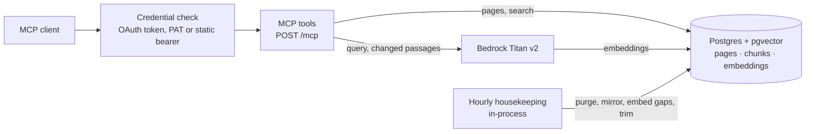

# ARCHITECTURE.md

This page shows what runs where: the AWS resources, the containers, and how a
request reaches Memrain. It is for people who run, change or review the
infrastructure. To install Memrain, start with
[docs/QUICKSTART.md](./docs/QUICKSTART.md); for a plain tour of how it answers
a question, read [docs/HOW-IT-WORKS.md](./docs/HOW-IT-WORKS.md).

> Source-of-truth diagram + inventory for the `memrain` stack.
> Updated alongside every terraform / compose / systemd change.

## Topology

```
   MCP clients (Claude Code, Codex,                 the owner in a browser
   claude.ai, ChatGPT, Copilot)                     (admin panel, passkey)
                │                                          │
   https://brain.example.com/mcp          https://brain.example.com/admin
                └──────────────────┬───────────────────────┘
                                   ▼
                  cloudflared (sidecar)  or  caddy (ingress_mode = "caddy")
                                   │
                ┌── docker-compose internal bridge ──┐
                                   │
     memrain  (/health · /mcp · OAuth · /admin)
       └─ hourly housekeeping, in-process (memrain-cycle lock)
                                   │
          Bedrock Titan v2 (embeddings only; none with MEMRAIN_KEYWORD_ONLY=1)
                                   │
          RDS Postgres + pgvector  (directly, or through PgBouncer)
                                   │
                  EFS (container runtime state, operator content)
                                   │
       AWS Secrets Manager (incl. the optional connector key)
```

The stack runs as one VPC + one EC2 + one RDS + one EFS in a single AWS
region. There are no autoscaling groups, no orchestrator, no message broker,
no job worker and no daemons: one server process does all of the work.

Without AWS, the same container runs on an embedded PGLite database with
keyword-only search (`deploy/docker-compose.local.yml`, `make local-up`).

## Container inventory

| Container | Image | Owns |
|---|---|---|
| `memrain` | built from `deploy/memrain/` (Bun + Alpine) | The brain: page store with version history, markdown chunking, Titan embeddings, hybrid keyword + vector search, links and tags, the MCP server (29 tools), Memrain's own OAuth 2.1 server, the passkey-protected admin panel, and the hourly housekeeping. Every route except `GET /health`, the OAuth metadata and flow endpoints (`/.well-known/*`, `/authorize`, `/token`, `/register`, `/revoke`) and the `/admin` pages (which carry their own sign-in) needs a credential. `POST /mcp` is the agent contract. Answer synthesis is the MCP client's job. |
| `cloudflared` | `cloudflare/cloudflared:2025.4.0` (upstream) | Public HTTPS ingress (Cloudflare Tunnel), the default `ingress_mode`. The dashboard routes `brain.example.com/mcp` to Memrain on the internal docker bridge. |
| `caddy` | `caddy:2.10` (upstream) | The alternative ingress (`ingress_mode = "caddy"`): terminates TLS with Let's Encrypt on the instance's own public IP, no tunnel. Runs as a compose override, so exactly one of the two ingress containers exists per deployment. See [`docs/DEPLOYMENT.md`](./docs/DEPLOYMENT.md#alternative-caddy-ingress-no-cloudflare). |

Inter-container ports are not exposed to the host. `cloudflared` reaches the
Memrain MCP server over the compose `internal` bridge network on
`memrain:18790`. The service also answers to the network alias `memex`, so an
ingress configured before the rename to Memrain keeps working.

`/health` answers `ok`, the running build stamp and `edition: "lite"`.

## Memrain server — internal modules

| Module | Responsibility |
|---|---|
| `commands/serve.ts` | Boot: refuses to start when `MEMRAIN_TENANT_ID` or `MEMRAIN_CONTROL_URL` is set (`core/startup-guard.ts`; every CLI entry point checks the same), opens the engine, runs migrations, starts the HTTP server and the hourly housekeeping, and drains housekeeping before shutdown. |
| `core/engine/{factory,pglite,postgres,interface}.ts` | Engine abstraction. `factory.makeEngine(config)` returns either a PGLite or a postgres-js adapter; both implement the same `transaction()` surface so the migration runner is atomic on either backend. |
| `core/migrate.ts` | Single-transaction migration runner: each migration's SQL and its `migrations` row commit together. |
| `core/pages.ts` + `core/page-edit.ts` + `core/page-index.ts` | The page store: versioned writes under a per-slug lock, conditional writes (`expected_version`), soft delete, revert, rename with redirects, and the page's search mirror written inline after each change. |
| `core/indexer.ts` + `core/chunkers/recursive.ts` + `core/sweep.ts` | Indexing: markdown split into passages, embedded, stored. A chunk whose text is unchanged keeps its stored vector. A spent budget or a passing Bedrock failure stores the chunk without a vector for housekeeping to fill; a failure that would repeat aborts before the database is touched. `sweep.ts` backs `memrain reindex` over a markdown folder. |
| `core/embedding.ts` + `core/embed-backfill.ts` + `core/embed-skip.ts` + `core/embedding-input-hash.ts` | Titan v2 embeddings (1024 dimensions). Each vector stores a signature (model, width) and a hash of its exact input, so only changed input is re-embedded. `embed-skip.ts` marks oversize or junk content as keyword-only. |
| `core/search/*` | Hybrid search (`hybrid.ts`): Postgres full-text and pgvector arms with the source scope, visibility and filters pushed into both, reciprocal rank fusion, at most two chunks per page, token budget. `exact.ts` backs `search_exact`. No model call except the query embedding. |
| `core/content-sanity.ts` + `core/quarantine.ts` | Ingest quality gate at the indexer: scraper junk is quarantined (kept, out of search, never embedded), oversize content is kept keyword-only, markup-heavy content is flagged. |
| `core/secret-scan*.ts` + `core/secret-store.ts` + `core/vault.ts` | Credentials in a page write are replaced by `[REDACTED:<kind>:<fingerprint>]` markers before storage. The originals are sealed with AES-256-GCM under the connector key and bound to their page and source, so `memrain secrets reveal|restore` can act on them. Without the key nothing is kept. |
| `core/write-gate*.ts` + `core/trust-tier.ts` + `core/trust-frame.ts` | The write gate: a deterministic detector for text that reads as instructions to an AI, run when outside text (and, if switched on, agent text) is indexed. Rows record the least trusted writer; outside and agent text is read back inside a trust frame. |
| `core/output-redaction.ts` | Read-side credential scan over every retrieval result returned to a non-operator caller. |
| `core/scope.ts` + `core/source-scope.ts` + `core/visibility.ts` | Source scoping. Every row carries a `source_id`; application-layer scoping plus write-time fail-closed checks confine each remote credential (OAuth client / PAT) to its granted sources. `scope.ts` defines the scope hierarchy (`admin` ⊃ `write` ⊃ `read`). |
| `core/caller-access.ts` + `core/owner-only.ts` | Who the brain's owner is and which sources are owner-only. An owner-only source is read only by the local operator and a credential bound to the owner; for everyone else it does not exist. |
| `core/oauth-provider.ts` + `http/oauth-endpoints.ts` + `http/oauth-metadata.ts` | Memrain's own OAuth 2.1 server and token verifier (see [OAuth flow](#oauth-flow)). Personal access tokens resolve through the same verifier. A credential bound to a member other than the enabled owner, or carrying a read floor (`min_trust`), is refused with `credential_unsupported`. |
| `mcp/operations.ts` + `mcp/dispatch.ts` | The tool contract (names, parameters, scopes) and the handlers. The JSON Schema in `tools/list` is generated from `operations.ts`. |
| `mcp/visibility.ts` + `mcp/surface.ts` | The one predicate behind `tools/list` and `tools/call`: the ingress walls (public denylist, internal-token wall) and the per-credential gates (fail-closed write source, operator-only tools, per-op scope, slug-bound deny-by-default, tool surface). A listed tool is never refused for scope or permission. Argument-level refusals (a slug outside the bound prefixes) stay in dispatch. |
| `mcp/http_transport.ts` + `mcp/rate_limit.ts` | MCP JSON-RPC handler. Public and internal traffic use separate token-bucket limiters (public keyed on Cloudflare's `Cf-Connecting-Ip`); an optional per-token limit sits behind authentication. Idle buckets are evicted, so memory stays bounded. |
| `http/public_guard.ts` | Detects a public request, checks the static bearer in constant time, and keeps the destructive and raw-text tools off the static bearer (constructive writes only with `MEMRAIN_PUBLIC_WRITE=1`). |
| `http/admin*.ts` | The admin panel: passkey sign-in (WebAuthn), setup links, recovery codes, and the API behind the Login, Setup, Enroll, Health, Pages, Search, Agents (credentials) and Security pages. |
| `http/body_limit.ts` + `core/path_guard.ts` | 1 MiB POST body cap (`MEMRAIN_MAX_BODY_BYTES`). The `index` tool's `path` form is confined to `MEMRAIN_VAULT_PATHS` / `MEMRAIN_CODE_PATHS`, symlinks resolved, with a dotfile / `.env` / `.git` / `.ssh` / credentials deny-list inside the roots. |
| `core/write-requests.ts` | Retry-safe writes: a `request_id` claims a `write_requests` row keyed by caller grant, tool and id, so a retry replays the stored result. |
| `core/budget.ts` | The spend ledger: every Titan call is held at its maximum cost against the brain's daily cap (`MEMRAIN_DAILY_BUDGET_USD`) and the calling client's daily cap before it is sent, then settled. |
| `core/housekeeping.ts` | The hourly in-process pass (see [Background work](#background-work)). |
| `core/transcripts/*` | Transcript import behind `memrain transcripts ingest`: ChatGPT, Claude.ai, Codex rollout and Claude Code session adapters; only what was said is kept, secrets are redacted, long sessions split at message boundaries. |
| `core/lite-doctor.ts` | The checks behind `memrain doctor` and the `run_doctor` tool. Read-only. |

## Access

Agents reach Memrain over MCP. The owner also uses the admin panel, which
carries its own passkey sign-in. The request path:



In detail:

```
MCP client (Claude Code / Copilot / Codex)
      │  Authorization: Bearer <OAuth token | personal access token | public bearer>
      ▼
https://brain.example.com/mcp   →  cloudflared  →  memrain:18790  POST /mcp
      │
      └─ tools/call { name: "search", arguments: { q, k } }  → hybrid retrieval
         (memrain returns cited chunks; the MCP client composes the answer)
```

Hard guarantees:

- **Every request has a credential.** A public `/mcp` request carries an
  OAuth access token, a personal access token or, if configured, the static
  public bearer (`MEMRAIN_PUBLIC_AUTH=oauth` drops the static bearer). A
  request from the docker bridge carries `MEMRAIN_INTERNAL_TOKEN`.
- **Static bearer is read-mostly.** The destructive writes and the tools that
  return raw text, slugs or tags are never reachable with it; constructive
  writes only with `MEMRAIN_PUBLIC_WRITE=1`. Its read results omit page bodies
  unless `MEMRAIN_PUBLIC_READ_BODIES=1`.
- **Grants, not trust.** An OAuth client or token reads and writes only inside
  its sources and scopes, optionally only under its bound slug prefixes and on
  a narrowed tool surface. `stats` and `run_doctor` are operator-only.
- **`tools/list` is what the caller can call** (`mcp/visibility.ts`). Each
  tool carries MCP `annotations` (`readOnlyHint`, `destructiveHint`,
  `idempotentHint`) derived from its scope.
- **Outside text is framed.** Retrieved text from outside or from an agent is
  returned inside an escaped `<external_content>` frame; text the write gate
  flagged carries an extra notice.

### OAuth flow

Memrain is its own OAuth 2.1 authorization server and protected resource
(`http/oauth-endpoints.ts`, `http/oauth-metadata.ts`, `core/oauth-provider.ts`).

- **Discovery.** Protected-resource metadata (RFC 9728) is served at the path
  form `/.well-known/oauth-protected-resource/mcp`, which a client pointed at
  `<issuer>/mcp` derives, and at the bare path for clients that cached it; both
  name `resource: <issuer>/mcp`. The `/mcp` 401 challenge points at the path
  form, and a request with no credential gets no `invalid_token` error code.
  Both metadata documents advertise `scopes_supported: ["read", "write"]`.
  Any other `/.well-known/` probe is a 404.
- **Resource binding (RFC 8707).** The `resource` approved at `/authorize`
  (`<issuer>` or `<issuer>/mcp`, stored as `<issuer>/mcp`) carries into the
  access and refresh tokens and survives rotation; any other value is
  `invalid_target`, at `/token` before the code or refresh token is consumed.
  `/mcp` refuses a token bound to another resource; unbound tokens (older
  tokens, PATs, `client_credentials`) are accepted. The issuer comes from
  `MEMRAIN_PUBLIC_URL`, or from the request when that is unset.
- **Codes.** A code records the client's `grant_revision`; a rescope between
  `/authorize` and `/token` makes it `invalid_grant`. `grant_types` is
  enforced on both grants, and `/authorize` redirects carry RFC 9207 `iss`.
  Dynamic client registration (`/register`) is off unless
  `MEMRAIN_ENABLE_DCR` turns it on.
- **Refresh families.** Every token minted from one sign-in shares a
  `family_id`, and a rotated refresh token leaves its hash in
  `oauth_refresh_consumed`. A replay within 60 seconds is refused as a
  retry; a later replay is refused and logged as reuse, and with
  `MEMRAIN_OAUTH_REFRESH_REUSE_REVOKE=1` the whole family is deleted. Per-client
  access and refresh lifetimes override the 1 hour / 30 day defaults.
- **Enrollment.** On an enrollment-mode client the operator issues one-time
  codes (`memrain auth enroll`, or the admin Enroll page) that pin a single
  authorization to a source; codes are single-use, expiring and revocable, and
  only their SHA-256 is stored. `invalidate-tokens` drops a client's tokens and
  codes without touching the client or its secret, and `revoke-client` marks
  the client deleted and deletes its tokens, keeping its grant history and
  spend rows.

## AWS resource inventory

| Layer | Resource | Created by | Notes |
|---|---|---|---|
| Network | VPC, public subnet, IGW, route table | `terraform/vpc.tf` | Single AZ for the live instance. |
| Network | Security group | `terraform/ec2.tf` | Nothing inbound in tunnel mode. Conditional SSH egress (only when `use_ssh_deploy_key = true`). |
| Compute | EC2 (`t4g.medium` by default, on-demand) | `terraform/compute.tf` | `lifecycle.ignore_changes = [ami, user_data]` — never replace on plan. |
| Compute | EIP | `terraform/compute.tf` | Public IP for the Cloudflare Tunnel edge port (7844) or Caddy. |
| Storage | EFS file system + mount target | `terraform/efs.tf` | Container runtime state and the operator content mounted read-only at `/memory`. Optional AWS Backup policy. |
| Storage | RDS Postgres 16 (`db.t4g.micro` by default) | `terraform/rds.tf` | The brain; `pgvector` enabled, storage encrypted, 7-day backups. Chunk embeddings are stored as `halfvec(1024)` with an HNSW index (migration 191) so the index stays inside the instance's small cache. Never rebuild that index with `REINDEX ... CONCURRENTLY` on a small instance. |
| Storage | S3 — terraform state | `terraform/main.tf` (partial backend) | Bucket supplied via `terraform/backend.hcl` from `make init`. |
| Storage | S3 — scripts | `terraform/ec2.tf` | `<project>-scripts-<account_id>`; holds `scripts/bootstrap.sh`. |
| Identity | IAM role + instance profile | `terraform/iam.tf` | Bedrock invoke on Titan Text Embeddings v2 only (no generative model is reachable), Secrets Manager read/rotate on its own prefix, CloudWatch Logs write. |
| Secrets | AWS Secrets Manager | `terraform/secrets.tf` | All credentials live here. Naming: `<secrets_prefix>/<name>`. |
| Observability | CloudWatch log group | `terraform/cloudwatch.tf` | `/<project>/app`, 14-day retention. |
| Observability | SNS topic + email subscription | `terraform/cloudwatch.tf` | Conditional on `alarm_email != ""`. |
| Audit | CloudTrail | `terraform/cloudtrail.tf` | Conditional on `enable_cloudtrail = true`. Multi-region trail by default — captures IAM/STS calls regardless of source region. |

## Background work

There is one background loop, inside the server process: the hourly
housekeeping (`core/housekeeping.ts`), first run five minutes after boot.

| Step | Does |
|---|---|
| `purge` | Hard-deletes documents soft-deleted more than 72 hours ago and pages soft-deleted more than 720 hours ago, with what was derived from them. |
| `mirror_pages` | Rebuilds a missing or stale search mirror for live pages (`MEMRAIN_MIRROR_PAGES_MAX_PER_RUN`, 200). |
| `embed_gaps` | Embeds chunks stored without a vector (`MEMRAIN_EMBED_GAPS_MAX_PER_RUN`, 200), under the daily cap. |
| `tokens` | Deletes expired OAuth tokens, codes and refresh tombstones. |
| `reservations` | Expires spend reservations a crashed call never settled. |
| `retention` | Request-log rows past `MEMRAIN_REQUEST_LOG_RETENTION_DAYS` (180), write receipts past their 7-day replay window, and chat history an older install kept, past `MEMRAIN_CHAT_RETENTION_DAYS`. |

The run holds the `memrain-cycle` row in `cycle_locks`, so two processes on
one database never overlap, and a lost lock stops the run before its next
step. A failed step is recorded and the next one runs. The finish time is kept
in `config` under `housekeeping.last_run` for the doctor. `MEMRAIN_CYCLE=0`
turns housekeeping off, `MEMRAIN_MAINTENANCE=1` turns off every background
write, and the steps that delete or rebuild also obey
`MEMRAIN_DAEMONS_DISABLED=cycle`, a paused `daemon_controls` row and
`MEMRAIN_CYCLE_SKIP_PHASES`, so an install that had switched its maintenance
off keeps its rows.

On the host, one optional systemd unit ships in `deploy/systemd/`:
`memrain-rotate-bearer.timer` (not installed by bootstrap) rotates
`<secrets_prefix>/memrain-public-bearer`, restages `.secrets/memrain.env` and
restarts `memrain`. Static checks in `tests/test_systemd_units.py` ensure every
shipped unit references a script that exists in the repo.

## Storage layout

```
/mnt/<project>-efs/<project>/      # EFS mount on the EC2 host
└── memrain/                       # Memrain runtime config

/mnt/<project>-efs/workspace/memory  # operator content, mounted read-only at /memory

/opt/<project>/                    # repo checkout (cloned by bootstrap.sh)
├── .env                           # rendered by bootstrap.sh on first boot (re-run by hand via SSM)
├── deploy/                        # compose + container build contexts
├── scripts/                       # bootstrap, init, audit, helpers
└── terraform/                     # infra-as-code
```

The authoritative store is Postgres (RDS on AWS, PGLite locally), evolved by
the numbered migration runner (`core/migrate.ts`, through migration 196). The
tables this build reads and writes:

- `pages` and their version history, `slug_aliases` (redirects after a
  rename), tags, and typed `links` with optional validity dates.
- `documents`, `chunks` and `embeddings` — the search index, with each
  vector's signature and input hash.
- `sources` — every row carries a `source_id`; a source can be owner-only or
  federated (`memrain sources federate <id>`: unscoped reads reach it).
- The secret store (migration 180): sealed originals of redacted credentials
  and the places their markers landed.
- `write_gate_holds` and `write_gate_row_holds` — text the write gate held.
- `oauth_clients`, `oauth_codes`, `oauth_tokens`, `oauth_refresh_consumed`,
  `oauth_enrollments` and `access_tokens` (personal access tokens, hash only),
  plus the admin passkey tables.
- `write_requests` — one row per caller grant, tool and `request_id`.
- `mcp_request_log` — one row per tool call from a credential (and every call
  with `MEMRAIN_REQUEST_LOG_DB=1`), trimmed by housekeeping.
- The spend ledger and its reservations, and `cycle_locks`.

The schema is the same one 0.25 ended on. Tables that hold the data of
features this build does not have stay in place, untouched: nothing reads or
deletes them, except that purging a page also removes rows keyed to it and
housekeeping trims old chat history. See [UPGRADING.md](./UPGRADING.md).

## Secrets — what goes where

| Secret name (under `<secrets_prefix>/`) | Consumer | Set by |
|---|---|---|
| `cloudflared-tunnel-token` | cloudflared | Manual; from the Cloudflare Zero Trust dashboard. Only in tunnel mode. |
| `memrain-postgres-url` | Memrain | terraform — auto-populated from the RDS endpoint. |
| `memrain-public-bearer` | Memrain | terraform — `random_password` at apply. Memrain checks incoming static public bearers against it. Static unless the optional `memrain-rotate-bearer.timer` is installed. |
| `memrain-internal-token` | Memrain (internal ingress) | terraform — `random_password` at apply; the credential for requests from the docker bridge. |
| `github-deploy-key` | bootstrap | terraform — conditional, only when `use_ssh_deploy_key = true`. |
| `memrain-connector-kek` (optional) | Memrain (as `MEMRAIN_CONNECTOR_KEK`): seals the originals the secret scan redacts | terraform creates the empty secret when `enable_connector_kek_secret = true`; the operator puts the value in by hand. Without it, redacted originals are not kept. |

`deploy/secrets/fetch-secrets.sh` reads these into the on-host
`deploy/.secrets/*.env` files. Containers `env_file:` mount those at
container start; Memrain reads `MEMRAIN_PUBLIC_BEARER` from `memrain.env`.

## Deploy flow

```bash
# From a maintainer laptop:
git push origin main

# From any shell on the EC2 (use AWS SSM Session Manager):
cd /opt/<project>
git pull --ff-only
bash deploy/secrets/fetch-secrets.sh                   # only if a secret changed
bash deploy/deploy.sh                                  # stamps, builds, waits healthy,
                                                       # then asserts the running
                                                       # container serves that stamp
```

The boot flow (cold start from a new instance):

1. cloud-init writes `/etc/stack-env` from terraform user_data vars.
2. cloud-init downloads `scripts/bootstrap.sh` from the scripts S3 bucket.
3. `bootstrap.sh` installs docker, mounts EFS, clones the repo,
   conditionally fetches the SSH deploy key, renders `/opt/<project>/.env`,
   runs `fetch-secrets.sh`, and brings up the two-container compose
   stack (`memrain` and its ingress).

## Why this shape

- **Single EC2, no orchestrator.** One person's memory does not need a
  scheduler or a fleet. The whole stack survives a
  `docker compose up -d --build`.
- **One process, no worker.** Everything a brain must do on its own fits in
  one hourly in-process pass under a database lock; there is no queue to
  drain and nothing to keep in step.
- **EFS for state, RDS for the brain.** EFS keeps runtime state and operator
  content across instance replacements. RDS keeps the brain across container
  rebuilds (PGLite on EFS lost data on SIGKILL, which is why the AWS deploy
  uses RDS).
- **Cloudflare Tunnel, no public ports.** In tunnel mode the EC2 security
  group opens nothing inbound; cloudflared dials out on tcp/7844 only. SSH is
  opt-in via `ssh_allowed_cidr`; SSM Session Manager is the default access
  path.
- **Embeddings only.** Titan v2 is the one model call, and the instance role
  can invoke nothing else. Ranking, filtering and safety checks are
  deterministic, so a search costs one embedding and a page write costs one per
  changed passage. Answer synthesis is the MCP client's job.
- **MCP for agents, no agent framework.** Agents reach Memrain over plain MCP
  JSON-RPC: one contract, no bot, no bespoke API.
- **Scoped credentials.** Every row carries a `source_id`. Enforcement is
  application-layer scoping plus write-time fail-closed checks; Postgres RLS
  is not the enforcement (migration 049 enables RLS only when the migrating
  role has BYPASSRLS, which a stock RDS role lacks, and adds no policies).
  Each remote credential sees only its granted sources, so a leaked app token
  does not expose the whole brain.

## Out of scope

- Multi-region failover.
- Read replicas / horizontal scaling.
- ASG + spot fleet (the current shape is one on-demand instance with
  `lifecycle.ignore_changes`).
