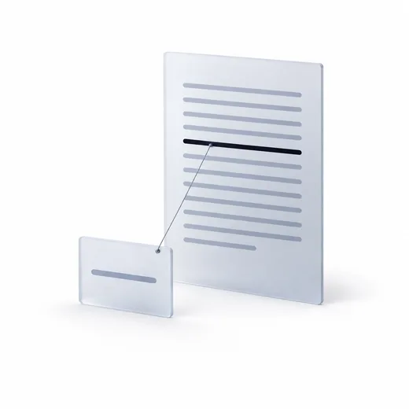

<div align="center">

<picture>
  <source media="(prefers-color-scheme: dark)" srcset="docs/assets/logo/logo-lockup-dark.svg">
  
</picture>

**Long-term memory for your AI agents.**<br>
Your notes and decisions, searchable from Claude, ChatGPT and Codex. Every result points to the page it came from.


[](./LICENSE)


</div>

**Memrain Lite is one person's memory for their AI agents.** It is free and
open source (MIT) and runs in your own AWS account, so you pay only your AWS
bill: about $52 a month for the server and database, plus a few cents of
embedding calls, under a daily cap you set. **To start, follow
[docs/QUICKSTART.md](./docs/QUICKSTART.md).**

## Why

- **Your agent forgets.** Every new chat starts from zero, so you paste the same context again and again.
- **Your knowledge is scattered.** Decisions sit in notes, the reasons in old chats, the details in other places.
- **Answers without sources are guesses.** You cannot check an answer that does not say where it came from.

Memrain keeps your notes as pages in one place and lets every agent you use
search them. Each result points to the exact page it came from.

## What you get

| | |
|---|---|
|  | **Answers you can check.** Ask "what did we decide about the auth flow?" and get the passages from your own notes, each with the page it came from. Your agent writes the answer; Memrain supplies the evidence. |

- **Pages with history.** Every write keeps a version; read, revert or
  restore any of them. Rename a page and its links and history follow it.
- **Search by meaning and by words.** A keyword arm and a vector arm (Bedrock
  Titan embeddings), fused into one ranked list, plus an exact-phrase lookup.
  Without AWS it runs keyword-only.
- **Links and tags.** `[[wikilinks]]` are linked on write; typed links, tags
  and backlinks answer "what points here".
- **Chat history import.** ChatGPT, Claude, Codex and Claude Code exports
  become searchable pages ([docs/TRANSCRIPTS.md](./docs/TRANSCRIPTS.md)).
- **Secrets stripped on the way in.** API keys, tokens, private keys and
  database passwords are redacted before anything is stored; the originals
  are kept encrypted for you alone.
- **Guarded writes.** Text written as instructions to an AI is held by the
  write gate, odd content is quarantined, and owner-only sources stay hidden
  from every other credential.

### The 29 tools

A client sees up to these 29 ([docs/TOOLS.md](./docs/TOOLS.md)); its scopes, its tool surface and the ingress it comes through decide which:

| Kind | Tools |
|---|---|
| Search | `search`, `search_exact`, `resolve_slugs`, `get_chunks` |
| Read pages | `page_get`, `page_list`, `page_versions` |
| Write pages | `page_put`, `page_append`, `page_edit`, `page_rename`, `page_delete`, `page_restore`, `page_revert`, `purge_deleted_pages`, `index` |
| Links and tags | `link`, `unlink`, `get_links`, `backlinks`, `add_tag`, `remove_tag`, `get_tags` |
| Brain and access | `get_brain_identity`, `whoami`, `stats`, `sources_list`, `sources_status`, `run_doctor` |

Memrain Lite is the single-person edition; a fuller edition with team and
connector features exists separately. Coming from 0.25 or earlier? Read
[UPGRADING.md](./UPGRADING.md#0260) first.

## See it work

<div align="center">
  
</div>

## How it works

Memrain does the remembering, not the talking. It returns ranked passages with
their sources, and your agent writes the answer from them. A search costs one
embedding call and never a chat-model call. The full pipeline is in
[docs/HOW-IT-WORKS.md](./docs/HOW-IT-WORKS.md).

## Get started

**Self-host (free software; you pay your AWS bill).** You need an AWS account
with Bedrock access, Terraform, the AWS CLI, an S3 bucket for Terraform state,
and a domain on Cloudflare (or on Route53, with the Caddy option). Fork the repo
to your GitHub account, then:

```bash
git clone https://github.com/<your-github-username>/memrain.git && cd memrain
make init      # answers a few questions and writes your config
make plan && make apply
```

The full walkthrough, from the tunnel token to your first search, is in
[docs/QUICKSTART.md](./docs/QUICKSTART.md).

**Try it on your laptop.** No servers, one embedded database. With Docker
alone, `make local-up` runs a keyword-only brain that needs no AWS account (see
[Try it locally without AWS](./docs/QUICKSTART.md#try-it-locally-without-aws)).
Semantic search needs AWS credentials for the embeddings; see
[Try it locally](./docs/QUICKSTART.md#try-it-locally).

## Connect your agent

Every client uses the same `https://<your-host>/mcp` address.

| Client | Guide |
|---|---|
| Claude Code | [docs/clients/CLAUDE_CODE.md](./docs/clients/CLAUDE_CODE.md) |
| Codex CLI | [docs/clients/CODEX.md](./docs/clients/CODEX.md) |
| claude.ai (Pro, Max) | [docs/clients/CLAUDE_AI.md](./docs/clients/CLAUDE_AI.md) |
| ChatGPT | [docs/clients/CHATGPT.md](./docs/clients/CHATGPT.md) |

## Security and privacy

- **Your data stays in your AWS account.** Notes, index and database live there. Only what an agent retrieves goes to that agent's model; with the default Cloudflare Tunnel, that traffic passes through Cloudflare. No vendor analytics or third-party telemetry; Memrain's own search telemetry, request and spend logs stay in your account.
- **Secrets are stripped on the way in.** Pasted AWS keys, API tokens, private keys and database passwords are redacted before they are stored or embedded.
- **Every agent has its own key.** Personal access tokens and OAuth clients you approve with a passkey, each scoped to its sources and tools, each with an optional daily cap, each revocable on its own. Details in [SECURITY.md](./SECURITY.md).

To report a vulnerability, see [SECURITY.md](./SECURITY.md).

## When Memrain is not the right fit

- You do not want to run anything in AWS. Without it, Memrain runs on your own machine keyword-only (`make local-up`).
- You want a general chat app. Memrain is the memory behind your agent; it does not answer questions itself.
- You want one memory for a team, or synced mail, calendars and chats. This edition serves one person and holds what you and your agents write into it.

## Documentation

| Doc | What is in it |
|---|---|
| [docs/QUICKSTART.md](./docs/QUICKSTART.md) | Install, connect, credentials, day-to-day operation |
| [docs/README.md](./docs/README.md) | Every document, one line each |
| [docs/HOW-IT-WORKS.md](./docs/HOW-IT-WORKS.md) | How ingest, search, caps and the safety checks work, what it costs |
| [docs/TOOLS.md](./docs/TOOLS.md) | The 29 MCP tools and their parameters |
| [docs/TRANSCRIPTS.md](./docs/TRANSCRIPTS.md) | Importing ChatGPT, Claude, Codex and Claude Code history |
| [docs/DEPLOYMENT.md](./docs/DEPLOYMENT.md) | Every install and update step in detail |
| [docs/CONFIGURATION.md](./docs/CONFIGURATION.md) | Every setting, its default, budgets |
| [ARCHITECTURE.md](./ARCHITECTURE.md) | What runs where, and the security model |
| [UPGRADING.md](./UPGRADING.md) · [CHANGELOG.md](./CHANGELOG.md) | Upgrades and release history |

## Contributing

Issues and pull requests are welcome. Please open an issue before anything that
adds infrastructure or changes how Memrain is deployed. The local checks and
test commands are in [CONTRIBUTING.md](./CONTRIBUTING.md).

## License

[MIT](./LICENSE)

The Memrain name and logo are not covered by the MIT licence; use them only to refer to this project.
