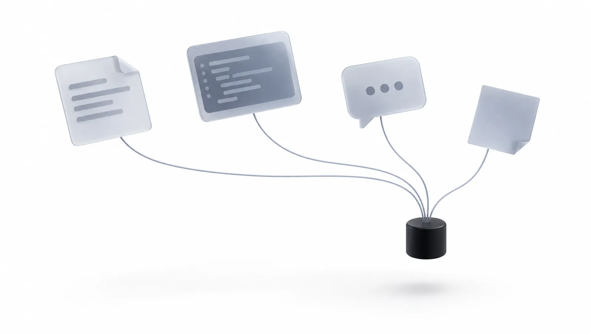
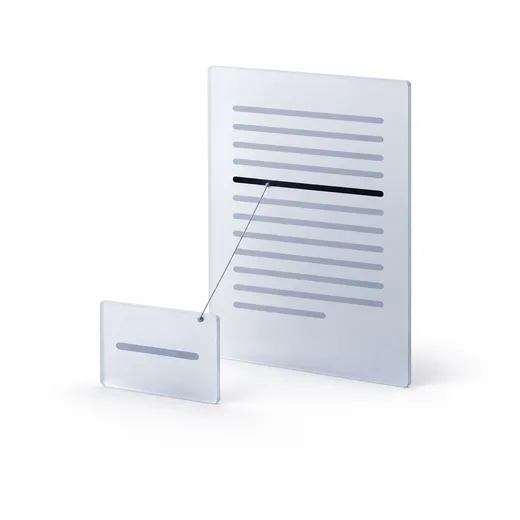
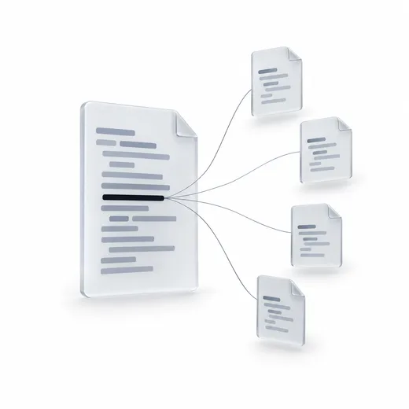
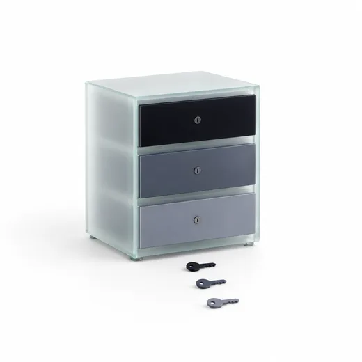

<div align="center">

<picture>
  <source media="(prefers-color-scheme: dark)" srcset="docs/assets/logo/logo-lockup-dark.svg">
  
</picture>

**Long-term memory for your AI agents.**<br>
Your notes, decisions and code, searchable from Claude, ChatGPT and Codex. Every result points to the page it came from.



[](./LICENSE)


</div>

**For developers and small teams who work with AI agents every day.** Memrain is
free and open source (MIT). It runs in your own AWS account, so you pay only your
AWS bill: about $52 a month for the server and database, plus model usage if you
turn on the paid features. **To start, follow [docs/QUICKSTART.md](./docs/QUICKSTART.md).**

## Why

- **Your agent forgets.** Every new chat starts from zero, so you paste the same context again and again.
- **Your knowledge is scattered.** Decisions sit in notes, the reasons in old chats, the details in code.
- **Answers without sources are guesses.** You cannot check an answer that does not say where it came from.

Memrain reads all of it, stores it in one place, and lets every agent you use
search it. Each result points to the exact page it came from.

## What you get

| | |
|---|---|
|  | **Answers you can check.** Ask "what did we decide about the auth flow?" and get the passages from your own notes, each with the page it came from. Your agent writes the answer; Memrain supplies the evidence. |
|  | **It understands your code.** Who calls this function, what breaks if I change it, where is it defined: for TypeScript, Python and Go. Bash and SQL files are searchable too. |
|  | **One memory for the team, a private space for each person.** One connector for everybody, a separate source per person, a daily spending cap, and access you can revoke one person at a time. |

It also keeps facts and timelines, imports your ChatGPT and Claude history,
keeps a version history for every page, and redacts API keys, tokens, private keys
and database passwords before anything is stored.

## See it work

<div align="center">
  
</div>

## How it works

<picture>
  <source media="(prefers-color-scheme: dark)" srcset="docs/assets/how-it-works-dark.svg">
  
</picture>

Memrain does the remembering, not the talking (the opt-in `think` tool is the
one exception). It returns ranked passages with
their sources, and your agent writes the answer from them. A search costs one
embedding call and no chat-model call by default. The full pipeline is in
[docs/HOW-IT-WORKS.md](./docs/HOW-IT-WORKS.md).

## Get started

**Self-host (free software; you pay your AWS bill).** You need an AWS account
with Bedrock access, Terraform, the AWS CLI, an S3 bucket for Terraform state,
and a domain on Cloudflare (or on Route53, with the Caddy option). Fork the repo
to your GitHub account, then:

```bash
git clone https://github.com/<your-github-username>/memrain.git && cd memrain
make init      # answers a few questions and writes your config
make plan && make apply
```

The full walkthrough, from the tunnel token to your first search, is in
[docs/QUICKSTART.md](./docs/QUICKSTART.md).

**Try it on your laptop.** No servers, one embedded database. You still need AWS
credentials for the embeddings. See
[Try it locally](./docs/QUICKSTART.md#try-it-locally).

**Hosted.** A hosted version, so you do not have to run AWS yourself, is planned. It is not available yet.

## Connect your agent

Every client uses the same `https://<your-host>/mcp` address.

| Client | Guide |
|---|---|
| Claude Code | [docs/clients/CLAUDE_CODE.md](./docs/clients/CLAUDE_CODE.md) |
| Codex CLI | [docs/clients/CODEX.md](./docs/clients/CODEX.md) |
| claude.ai (Pro, Max) | [docs/clients/CLAUDE_AI.md](./docs/clients/CLAUDE_AI.md) |
| Claude Team, Enterprise | [docs/clients/CLAUDE_TEAM.md](./docs/clients/CLAUDE_TEAM.md) |
| ChatGPT | [docs/clients/CHATGPT.md](./docs/clients/CHATGPT.md) |

## Security and privacy

- **Your data stays in your AWS account.** Notes, index and database live there. Only what an agent retrieves goes to that agent's model; with the default Cloudflare Tunnel, that traffic passes through Cloudflare. No vendor analytics or third-party telemetry; Memrain's own search telemetry, request and spend logs stay in your account.
- **Secrets are stripped on the way in.** Pasted AWS keys, API tokens, private keys and database passwords are redacted before they are stored or embedded.
- **Every person has their own key.** Personal tokens and OAuth sign-in, scoped per person, each with an optional daily cap. Details in [docs/TEAM-SETUP.md](./docs/TEAM-SETUP.md).

To report a vulnerability, see [SECURITY.md](./SECURITY.md).

## When Memrain is not the right fit

- You do not want to run anything in AWS. A hosted version is planned; it is not available yet.
- You want a chat app. Memrain is the memory behind your agent, not a chat window.

## Documentation

| Doc | What is in it |
|---|---|
| [docs/QUICKSTART.md](./docs/QUICKSTART.md) | Install, connect, credentials, day-to-day operation |
| [docs/HOW-IT-WORKS.md](./docs/HOW-IT-WORKS.md) | How search works, what it costs |
| [docs/TEAM-SETUP.md](./docs/TEAM-SETUP.md) | One connector for a team, a private space per person |
| [docs/DEPLOYMENT.md](./docs/DEPLOYMENT.md) | Every install and update step in detail |
| [docs/CONFIGURATION.md](./docs/CONFIGURATION.md) | Every setting, quality tiers, budgets |
| [ARCHITECTURE.md](./ARCHITECTURE.md) | What runs where, and the security model |
| [docs/FOR-COMPANIES.md](./docs/FOR-COMPANIES.md) | For companies: what you get, the limits, a one-week evaluation |
| [UPGRADING.md](./UPGRADING.md) · [CHANGELOG.md](./CHANGELOG.md) | Upgrades and release history |

## Contributing

Issues and pull requests are welcome. Please open an issue before anything that
adds infrastructure or changes how Memrain is deployed. The local checks and
test commands are in [CONTRIBUTING.md](./CONTRIBUTING.md).

## License

[MIT](./LICENSE)

The Memrain name and logo are not covered by the MIT licence; use them only to refer to this project.
