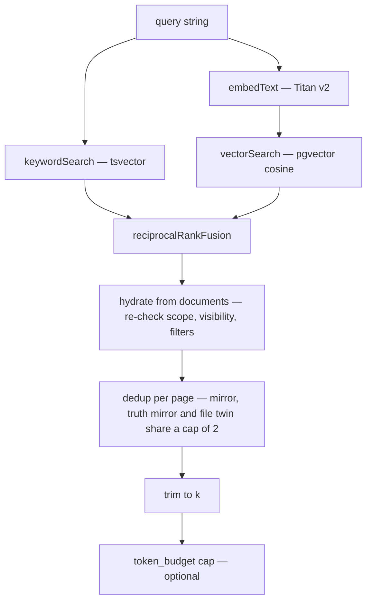

# Memrain — Architecture

Deep dive into the Memrain package. For project-level topology see
`ARCHITECTURE.md` at the repo root; this doc covers internal layout, the
engine, the schema, the search pipeline, housekeeping, and operational
boundaries.

## High-level layout

```
deploy/memrain/src/
├── cli.ts               argument parsing + dispatch (`--help` lists the commands)
├── commands/            one .ts per command
├── core/
│   ├── engine/          adapter pattern (PGLite + Postgres)
│   ├── chunkers/        recursive markdown chunker
│   ├── search/          hybrid search: keyword, vector, filters, dedup,
│   │                    token budget, exact-phrase scan
│   ├── transcripts/     chat-history importers
│   ├── migrations/      append-only NNN_*.sql
│   ├── housekeeping.ts  the hourly upkeep pass inside `serve`
│   ├── embedding.ts     Bedrock Titan v2 client
│   ├── indexer.ts       chunks → embed → write transaction
│   ├── pages.ts         page writes and versions
│   ├── links.ts, tags.ts, backlinks.ts
│   ├── secret-scan*.ts, write-gate*.ts, content-sanity.ts, quarantine.ts
│   ├── budget.ts        spend reservations against the daily caps
│   ├── oauth-provider.ts
│   ├── migrate.ts       versioned migration runner
│   ├── rrf.ts           Reciprocal Rank Fusion
│   ├── sweep.ts         vault walk + change detection
│   ├── storage.ts       thin façade over Engine
│   └── config.ts        JSON + YAML + env layered loader
├── http/                /health, /mcp, OAuth endpoints, /admin
└── mcp/                 JSON-RPC 2.0 transport, tool definitions, dispatch
```

## Engine adapter

`core/engine/interface.ts` declares a narrow surface — `kind`, `query`,
`exec`, `ready`, `close` — that PGLite and Postgres both implement.
`core/engine/factory.ts` instantiates the right adapter based on
`config.database.type` (`pglite | postgres`).

The AWS deploy runs `postgres` against the RDS instance defined in
`terraform/rds.tf`. PGLite serves the local install (`init --pglite`,
`make local-up`) and the test suite. PGLite admits one process at a time:
while `serve` holds it, other CLI commands refuse to start.

The migrations are engine-agnostic SQL — `vector(1024)` (or `halfvec(1024)`
where pgvector has it), `tsvector GENERATED ALWAYS AS`, `jsonb`, HNSW,
`TIMESTAMPTZ DEFAULT NOW()` — so new schema needs only a new
`migrations/NNN_*.sql` file. Append-only convention: never edit a shipped
migration; ship a new one. 0.26 ships no new migration; tables of pre-Lite
features stay in the schema, unused.

## Schema

The tables the Lite build reads and writes:

- `sources` — groups of pages: `id`, `kind`, `path_prefix`, policies, the
  owner-only and federated flags.
- `pages` and `page_versions` — the canonical record: slug, type, title,
  markdown body, frontmatter, source, soft-delete time; every write adds a
  version.
- `documents` — the search mirror of a page (or of an indexed file):
  `source_path`, `title`, `frontmatter`, `source_id`, `last_indexed_mtime`.
- `chunks` — passages of a document, with a generated `tsvector`.
- `embeddings` — one vector per chunk (`vector` or `halfvec`, 1024
  dimensions), with the model that made it.
- `links` and `tags` — `[[wikilinks]]`, typed links with optional validity
  dates, and page tags.
- OAuth clients and tokens, personal access tokens, admin passkeys, the
  spend ledger, the request log, the write-gate and quarantine queues, the
  sealed secret store, and `migrations`.

## Search pipeline

`core/search/hybrid.ts`:



- Both arms push the source scope, the visibility filter, the
  date/type/slug filters and the configured hard-excludes into their own SQL,
  so a filtered match is never pushed out by unfiltered ones.
- No model is called except the query embedding. A failed or slow embed falls
  back to keyword-only and says so in `meta` (`vectorEnabled: false`,
  `degraded`); a spent budget refuses the call with `budget_exhausted`.
- Owner-only, quarantine and write-gate fences and the trust frame are
  applied by `mcp/dispatch.ts` on the returned hits.
- **token_budget** (`token-budget.ts`): optional `search` param caps total
  returned context (~chars/4), keeping whole hits in rank order.
- `search_exact` (`exact.ts`) scans page bodies for a literal phrase, with no
  ranking and no embedding.

## Housekeeping

`core/housekeeping.ts` runs once an hour inside `serve` (first run five
minutes after boot), one process at a time under a database lock. Steps:
purge pages soft-deleted past their window, rebuild missing or stale search
mirrors, embed chunks written without a vector, sweep expired OAuth tokens,
expire spend reservations a crashed call never settled, and trim the request
log and pre-Lite chat history past their retention. A failing step is recorded and
the next one runs. No model is called; the only paid calls are the Titan
embeds, under the brain's daily cap. `MEMRAIN_CYCLE=0` turns it off; the other
switches are in [UPGRADING.md](../../../UPGRADING.md#0260).

## MCP JSON-RPC transport

`POST /mcp` accepts JSON-RPC 2.0. Methods:
- `initialize` — handshake, returns server info + capabilities
- `tools/list` — the tools this caller may call, from `mcp/operations.ts`
- `tools/call` — invokes a tool, returns content blocks
- `ping` — `{}`

The 29 tools and their parameters are in
[docs/TOOLS.md](../../../docs/TOOLS.md). The static public bearer sees seven
read tools and, by default, no page bodies (`core/public_redaction.ts`);
`FORBIDDEN_MCP_TOOLS_FROM_PUBLIC` in `http/public_guard.ts` lists what it may
never call. `stats` and `run_doctor` answer only the operator
(`OPERATOR_ONLY_TOOLS` in `mcp/visibility.ts`).

Per-IP rate limit (token bucket, default 60 req/min), configurable via
`mcp.rate_limit_per_minute` in `memrain.yml`.

## Bedrock model wiring

| Use | Model | Cost |
|---|---|---|
| Embeddings | `amazon.titan-embed-text-v2:0` | about $0.02 per million tokens |

That is the only model call. Answer synthesis is the MCP client's job; with
`MEMRAIN_KEYWORD_ONLY=1` nothing is embedded and no call is made.

Auth: EC2 IAM role + `AWS_PROFILE=default` env + container-mounted
`~/.aws/config` (`credential_source = Ec2InstanceMetadata`). The Terraform
policy allows Titan embeddings only.

## Configuration layering

Highest precedence → lowest:

1. `MEMRAIN_*` env vars (containers / one-off CLI invocations)
2. `~/.memrain/memrain.yml` (declarative knobs — MCP rate limits, vault
   paths, self-issued auth)
3. `~/.memrain/config.json` (boot essentials only — db type/path, embedding
   provider/model/region; written by `init`)
4. defaults compiled into `core/config.ts`

`config.ts::loadConfig` does the merge. `memrain config set` stores
overrides for known `MEMRAIN_*` keys in the database; a value in the process
environment still wins. The full list of settings is
[docs/CONFIGURATION.md](../../../docs/CONFIGURATION.md).

## Security boundary

- Memrain binds `0.0.0.0:18790` inside its container but the port is
  `expose:` only — never `ports:` — so it is reachable only on the Docker
  network and through the Cloudflare Tunnel or Caddy ingress for the public
  `/mcp` surface.
- All state outside `node_modules` lives on EFS / RDS — the container is
  stateless and re-creatable.
- The Postgres SG only allows ingress 5432 from the stack EC2 SG.
- Public-bearer access is limited by `FORBIDDEN_MCP_TOOLS_FROM_PUBLIC` and
  body redaction; writes from it need `MEMRAIN_PUBLIC_WRITE=1`. On the
  internal path, `MEMRAIN_INTERNAL_TOKEN` is required once it is set.
