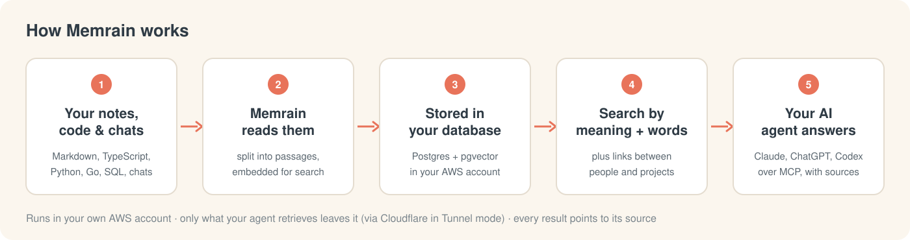

# How Memrain works

This page explains what Memrain does with your notes, how it answers a
question, and what it costs to run. The first sections need no setup
knowledge; the last ones are reference. For the setup
itself, see [QUICKSTART.md](./QUICKSTART.md).

<picture>
  <source media="(prefers-color-scheme: dark)" srcset="assets/how-it-works-dark.svg">
  
</picture>

## In one minute

Memrain is a memory, not a chatbot. It reads your notes, code and chat history,
remembers them, and when your AI agent asks a question it hands back the most
relevant passages, each with the page it came from. Your agent (Claude Code,
ChatGPT, Codex and so on) writes the answer from that evidence. The one
exception is the opt-in `think` tool, which writes a cited answer itself.

## 1. How your knowledge gets in

You point Memrain at your content: a folder of markdown notes, a code checkout,
or anything your agent saves through MCP. For each document it:

1. **Splits** it into short passages.
2. **Embeds** each passage: Amazon Titan on Bedrock turns it into a list of
   numbers that captures its meaning, so "car" can find "vehicle".
3. **Stores** everything in Postgres in your AWS account. The database is the
   record, not the files on disk.

Chat history comes in the same way. `memrain transcripts ingest` reads ChatGPT
and Claude.ai exports, Codex CLI rollouts (`~/.codex/sessions`) and Claude Code
session logs (`~/.claude/projects`), one file or a whole directory. It keeps
only what was said: tool calls and results, reasoning, sub-agent traffic and
system reminders are dropped, credentials are redacted, and a long session is
split into parts at message boundaries. Running it again on unchanged input
writes nothing.

## 2. How a question is answered

When your agent searches, Memrain:

1. **Works out what kind of question it is** (about a person or thing, a time
   span, an event, or general),
   with simple rules and no model call by default.
2. **Searches two ways at once**: by meaning, using the embedding of the
   question, and by exact words.
3. **Merges the two result lists** into one ranking, then favours the right
   kind of source and removes near-duplicates.
4. **Optionally reorders the top results** with a Claude model, if you turned
   that on.
5. **Returns the top passages, each with its source.**

A default search makes one Titan embedding call and no Claude call. Asking a
model to classify the question (`MEMRAIN_INTENT_LLM=1`), expanding the query
with related words (`MEMRAIN_QUERY_EXPANSION=1`) and reranking
(`MEMRAIN_RERANK=1`, or the paid Sonnet `MEMRAIN_GRAPH_RERANK=1`) are all
opt-in. When they are on, they improve which passages come back. They never
write the answer. The code is in `deploy/memrain/src/core/search/hybrid.ts`;
the two lists are merged with Reciprocal Rank Fusion.

One optional shortcut sits in front of all of this: a cache that recognises a
question you asked before, or a close paraphrase, and returns the earlier
result instead of searching again. It is off by default.

## 3. Where the money goes

Three cost layers, from pennies to real money:

| Layer | What it does | When it spends | Cost |
|-------|--------------|----------------|------|
| **Titan embeddings** | chunk fingerprints | on indexing + one query vector per search | pennies (~$0.026 / 1M tokens) |
| **Claude Haiku** (utility) | query intent / expansion / rerank only when `MEMRAIN_INTENT_LLM` / `MEMRAIN_QUERY_EXPANSION` / `MEMRAIN_RERANK` are on (the Balanced and Max tiers written by `scripts/init.sh` turn `MEMRAIN_RERANK` on); nightly synthesis; contextual embedding wrapper | only when those flags are on | cheap (~$1–15/mo) |
| **Claude Sonnet** (paid slices) | graph-aware rerank, relational reasoning, `think`, deep-synth, take grading | **only when a flag is set** | pay-per-call — the cost swing |

The dominant variable cost is **`MEMRAIN_GRAPH_RERANK`** — a paid Sonnet call on
*every* search, so it scales with how much you search. On top of that sits a
fixed infrastructure floor: one small EC2 instance + one RDS Postgres +
networking/secrets. See [CONFIGURATION.md](./CONFIGURATION.md#quality--cost-tiers-pick-one)
for the Free / Balanced / Max tiers and how to pick one.

The tier that `scripts/init.sh` picks (Balanced or Max turn `MEMRAIN_RERANK` on)
is written only to your local `.env`. A Terraform host runs the free tier until
you copy that block into the host's `.env`; see
[DEPLOYMENT.md](./DEPLOYMENT.md).

## 4. Why run LLMs *inside* the brain at all?

If the MCP client writes the answers, why does Memrain call models internally? Two
reasons — and neither is "chatting with the user":

**A. Sharper retrieval, at query time.**
- **Graph rerank** (Sonnet): reorders the top hits using the knowledge-graph
  connections between pages — the most relevant, best-connected hit rises.
- **Relational fallback** (Sonnet): kicks in only for relationship questions
  ("who founded X") when plain hybrid search underperforms.

**B. A knowledge layer, built in the background.**
- **Synthesis** (`MEMRAIN_DREAM_SYNTHESIS`, Haiku): on quiet-hours ticks the brain
  distils your notes into concepts, opinions ("takes"), and a calibration profile
  — stored in a *separate* store; your original notes are never touched.
- **Deep synthesis / take grading** (Sonnet): deepen and score those takes.
- **Facts** — Memrain pulls concrete claims ("Acme's contract renews in March") out
  of what you write, as you write it, and keeps them tidy: names are matched back
  to the right page instead of spawning duplicates, and a superseded claim is
  retired when a newer one lands. You can also *declare* facts yourself in a
  `## Facts` block on a page — those claims are yours, and the brain won't quietly
  drop them even as it prunes its own.
- **Reflections, then patterns** — over your recent sessions the brain writes short
  **reflections** (what happened, what was decided), then makes a second pass that
  reads across many reflections and surfaces the **patterns** — themes that keep
  recurring — as their own pages. Both are paid and off by default; reflections
  feed the pattern pass, so a run does both in order.
- **`think`** (Sonnet): an on-demand "reason deeply about this question" command
  that returns a synthesized, cited answer. For a *time* question ("when did X
  change, is it still true?") it figures out which entities you mean even if you
  didn't name one, and pulls in each one's **trajectory** — the log of how that
  thing changed over time — so the answer reflects the latest state, not a stale
  snapshot.
- **Contextual embeddings** (`MEMRAIN_CONTEXTUAL_LLM`, Haiku): before fingerprinting
  a chunk, prepend a short blurb situating it in its document ("from the note about
  the Acme deal…") so an otherwise-ambiguous chunk is found more reliably.

So internal models make search *more accurate* and let the brain *understand its
own content* — the final answer is still written by your MCP client using what was
retrieved.

## 5. One brain, scoped credentials — for one person or a team

A fresh install serves one person, and that is still the common case.
What makes more than one person possible is that **nothing trusts the caller**:
every remote credential (OAuth client or PAT) carries a write source and a
`federated_read` set, and reads and writes are confined to that grant. A leaked
app token never exposes the whole brain. Operational tools (`stats`, `advisor`,
the job queue) are operator-only regardless.

A **source** is the unit of separation, one per person. Search, page reads,
writes, tag checks and even the page counters all follow the caller's grant.

Where the grant comes from is the part worth knowing:

- normally from the **client row**, so one connector means one tenant;
- or from the **authorisation itself**, when the client is in *enrollment mode*.
  The operator issues a one-time code per person; the person presents it once
  at `/authorize`; that single authorisation is pinned to their source and the
  refresh token carries the pin. One connector, many people, separate tenants.

That second path exists because Claude Team and Enterprise let only an Owner
add a connector, once, for the whole organisation, and everyone authorises
against that same client. See
[CONFIGURATION.md](./CONFIGURATION.md#connecting-a-whole-team-through-one-connector).

## 6. The shape (and why)

Memrain is deliberately small: **one Docker container on one EC2 instance**, an
**RDS Postgres** for the index, an **EFS** mount for config that survives rebuilds,
and **AWS Secrets Manager** for the tokens. The public surface is `POST /mcp`, the
authenticated `POST /ingest`,
`GET /health`, the OAuth discovery and flow endpoints, and `/admin` (behind
its own sign-in), reached through a **Cloudflare Tunnel** — no load balancer, no
extra AWS ingress. (If you'd rather not depend on Cloudflare, the Caddy ingress
mode serves the same route over Let's Encrypt TLS on the instance's own IP; see
[DEPLOYMENT.md](./DEPLOYMENT.md#alternative-caddy-ingress-no-cloudflare).) It fits
on one small box and you can read the whole thing in an afternoon. Full topology
in [ARCHITECTURE.md](../ARCHITECTURE.md).

## 7. It maintains itself

A background cycle runs every few hours: it indexes new content, re-embeds stale
documents, and (during quiet hours) runs the synthesis layer — distilling takes,
writing reflections, and mining the patterns across them. It's careful not to
waste effort: editing one line of a page re-embeds only the chunk that changed,
not the whole document, and it won't turn its own reflections and patterns back
into raw input for another pass. You don't schedule anything; Memrain keeps
itself current.

And it can check its own work. An opt-in nightly **eval probe** (runs only
after you install and enable `memrain-eval-probe.timer` from `deploy/systemd`)
runs a fixed set of questions against the brain and records how good the
retrieval was, so quality drift shows up as a trend you can read
(`memrain doctor`) rather than a surprise. It runs under a spend ceiling, so the
self-check can't run up a bill.

## 8. Under the hood: the tools

Memrain's MCP tools are declared in `deploy/memrain/src/mcp/operations.ts`; the
table below groups all of them. Each carries MCP `annotations` derived from its
scope: `readOnlyHint` on reads, and `destructiveHint` / `idempotentHint` on
writes, so a client can ask before it changes anything. The static public
bearer sees only a read subset; a personal access token or an OAuth client sees
what its scopes allow.

| Group | Tools |
|-------|-------|
| **Search & pages** | `search`, `query`, `think`, `recall`, `volunteer_context`, `context_pack`, `advisor`, `index`, `get_chunks`, `resolve_slugs`, `page_put`, `page_append`, `page_get`, `page_list`, `page_versions`, `page_revert`, `page_delete`, `page_restore`, `purge_deleted_pages`, `add_tag`, `remove_tag`, `get_tags`, `put_raw_data`, `get_raw_data`, `get_recent_transcripts` |
| **Code** | `code_def`, `code_refs`, `code_callers`, `code_callees`, `code_blast`, `code_flow` |
| **Facts, timeline & chronicle** | `add_fact`, `forget_fact`, `extract_facts`, `fact_supersessions`, `add_timeline_event`, `chronicle_day`, `chronicle_since`, `chronicle_on_this_day`, `chronicle_last_seen`, `chronicle_backfill`, `volunteer_chronicle`, `ontology_get`, `ontology_propose`, `ontology_dimensions`, `ontology_conflicts` |
| **Graph & entities** | `backlinks`, `link`, `unlink`, `get_links`, `list_link_sources`, `graph_neighbors`, `graph_query`, `traverse_graph`, `relational_recall`, `entity_facts`, `entity_timeline`, `entity_recall`, `find_orphans`, `wanted_pages`, `find_experts`, `find_contradictions`, `find_trajectory`, `find_anomalies`, `get_recent_salience`, `list_concepts` |
| **Takes** | `list_takes`, `takes_search`, `set_take_status`, `takes_scorecard`, `takes_calibration`, `get_calibration_profile` |
| **Jobs & agents** | `jobs_submit`, `jobs_cancel`, `jobs_list`, `jobs_get`, `jobs_logs`, `retry_job`, `get_job_progress`, `submit_agent`, `get_agent_job` |
| **Skills** | `list_skills`, `get_skill`, `list_brain_skillpack` |
| **Admin & diagnostics** | `stats`, `whoami`, `get_brain_identity`, `get_status_snapshot`, `run_doctor`, `source_health`, `sources_list`, `sources_status`, `log_friction`, `log_ingest`, `get_ingest_log` |

A few that are easy to miss:

- `context_pack` builds a "what matters now" pack for the start of a turn:
  entity cards (title, type, top facts, recent events) for the slugs you name or
  the entities a conversation window mentions, then the top facts across your
  grant, trimmed to a token budget. No LLM, read-only.
- `get_recent_transcripts` lists recently ingested meeting, email, journal and
  note pages, newest first, with a short summary or the capped body. It is not
  on the public ingress.
- Writes are safe to retry and to race. `page_put`, `page_append`, `add_fact`
  and `add_timeline_event` take an optional `request_id`: a retry with the same
  id and arguments returns the first result with `replayed: true` and writes
  nothing, so a timed-out append retried by a client does not land twice.
  `page_put`, `page_revert` and `page_delete` take an optional
  `expected_version` (from `page_get`): the write lands only if the page is
  still at that version, so of two writers that read the same version exactly
  one commits and the other gets `version_conflict`.
- `submit_agent` queues a read-only research agent that runs under your own
  grant, sources and daily budget, and `get_agent_job` returns its status and
  answer. Both need the `agent` scope, a daily budget on the client, and
  `MEMRAIN_AGENT_ENABLED=1` plus `MEMRAIN_AGENT_TENANT_ENABLED=1` on the host.
